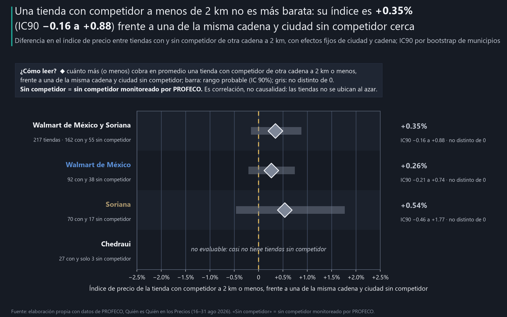

# ¿Un competidor a 2 km baja tus precios?

**Objetivo.** Mostrar a directores y dueños de cadenas si la competencia cercana cambia el precio de una tienda, como caso de competencia local para decisiones de expansión y de precio por tienda.

> 📊 **Reporte interactivo:** https://ernestrr.github.io/mexico-competencia-2km/

---

## La historia

Todo gerente de expansión ha escuchado la frase: *«si abre un Chedraui enfrente, nos toca bajar precios»*. Es intuitiva y se repite en cada junta de comité. Pero si fuera cierta, debería dejar huella: las tiendas con un rival de otra cadena a la vuelta de la esquina cobrarían menos que sus hermanas de la misma ciudad que compiten sin vecinos.

Para ponerla a prueba usé el archivo público de **Quién es Quién en los Precios de PROFECO** (quincena del 16 al 31 de agosto de 2026): miles de precios de anaquel levantados en supermercados de todo el país, con la coordenada de cada tienda. Con eso se puede medir, para cada sucursal, **cuánto cobra frente a las demás tiendas de su ciudad por los mismos productos**, y a qué distancia tiene al competidor más cercano.

La pregunta, entonces, es concreta:

**Una tienda de Walmart de México o Soriana con un competidor de otra cadena a menos de 2 km, ¿tiene precios distintos a una sin competidor cerca en la misma ciudad?**

## El hallazgo principal

**Una tienda de Walmart de México o Soriana con un competidor de otra cadena a menos de 2 km no es más barata: su índice de precio es +0.35% (IC90 −0.16 a +0.88%) frente a una de la misma cadena y ciudad sin competidor cerca.** La diferencia es de décimas de punto y no se distingue de cero. Es una correlación entre 217 tiendas, no un experimento: las cadenas no abren tiendas al azar. Y «sin competidor» significa sin competidor monitoreado por PROFECO.



Índice de la tienda = cuánto cobra, en promedio, frente a las otras tiendas de su ciudad por los mismos productos. Diferencia = coeficiente de «tiene competidor a 2 km» con efectos fijos de ciudad y cadena. IC90 = rango probable, por bootstrap de ciudades.

## Tres hallazgos de apoyo

1. **Con ningún radio aparece un descuento por competencia.** A 1 km la diferencia es +0.41% (IC90 +0.05 a +0.90%) y a 3 km +1.52% (IC90 +0.43 a +2.71%, con solo 23 tiendas sin competidor). Con la distancia continua, duplicar la distancia al competidor más cercano se asocia con −0.26% en el índice. Si algo, las tiendas con competencia cerca cobran apenas más, lo que es compatible con que estén en zonas urbanas más caras.
2. **Ningún tipo de competidor se asocia con precios más bajos.** Tener cerca una tienda de Chedraui: −0.27% (IC90 −0.83 a +0.13); de Soriana: +0.03%; de Walmart de México: +0.63% (IC90 −0.09 a +1.30); de otras cadenas: +0.49% (IC90 +0.04 a +1.07), el único distinto de cero, y hacia arriba.
3. **El precio se fija por ciudad, no por esquina.** Las sucursales del mismo formato en la misma ciudad cobran el mismo precio (±2%) en 86% de los productos en Walmart y 80% en Bodega Aurrerá. En Soriana las sucursales difieren más (59% en Hipermercado y 33% en Mega), pero esa diferencia no sigue a la competencia cercana.

**Lo que no resultó sólido.** El efecto por cadena no tiene precisión suficiente: Walmart de México +0.26% (IC90 −0.21 a +0.74) y Soriana +0.54% (IC90 −0.46 a +1.77); con 16 tiendas de Soriana sin competidor, un efecto de 1% no se podría descartar. Chedraui no se puede evaluar: solo 3 de sus tiendas no tienen competidor a 2 km. A 3 km la comparación descansa en 23 tiendas.

## Qué significa para el negocio y qué hacer

Aplica a los supermercados que monitorea PROFECO. «Sin competidor» quiere decir sin competidor monitoreado por PROFECO: puede haber tiendas cercanas que el archivo no visita. Correlación, no causalidad.

**Dirección comercial y de expansión**
- **No espere bajar precios al abrir junto a un competidor, ni subirlos donde no lo hay.** En el anaquel, la diferencia entre tiendas con y sin competidor a 2 km es de +0.35% y no se distingue de cero.
- **Evalúe la ubicación por tráfico y surtido, no por la guerra de precios local.** El precio de anaquel de las grandes cadenas se fija por ciudad: 86% de los productos cuesta lo mismo en todas las sucursales de Walmart de la ciudad.

**Dueño de tienda o cadena**
- **Si su precio varía entre sucursales, que sea por una razón.** En Soriana las sucursales del mismo formato difieren más que en Walmart, pero esa variación no responde a la competencia cercana: es costo sin estrategia.
- **La competencia local se libra en promociones, servicio y surtido.** Este análisis solo ve el precio de anaquel de la quincena; ahí la competencia de la esquina no se nota.

**Analista comercial**
- **Compare tiendas de la misma cadena y ciudad.** Comparar ciudades distintas confunde el costo de la ciudad con la competencia.
- **Revise la cobertura antes de estimar.** A 3 km solo quedan 23 tiendas sin competidor; con tan pocas, cualquier cifra es frágil.
- **Diga qué significa «sin competidor».** Aquí, sin competidor monitoreado por PROFECO.

## Cómo se hizo (breve)

- Supermercados monitoreados por PROFECO del 16 al 31 de agosto de 2026, con coordenada confiable (315 de 319).
- Índice de cada tienda: promedio de log(precio / precio promedio del mismo SKU en las otras tiendas de su municipio), con una mediana de 991 productos por tienda.
- Competidor = supermercado de otro grupo monitoreado por PROFECO a 2 km o menos (sensibilidad: 1 y 3 km y distancia continua).
- Regresión del índice con efectos fijos de ciudad y cadena; IC90 por bootstrap de municipios (500 réplicas, semilla 2026). Walmart de México y Soriana; Chedraui no evaluable.

## Limitaciones

- **Universo:** solo tiendas monitoreadas por PROFECO; una tienda «sin competidor» puede tener cerca una tienda que PROFECO no visita.
- **Causalidad:** las cadenas eligen dónde abrir; una diferencia (o la falta de ella) no prueba que la competencia mueva o no el precio.
- **Potencia:** 55 tiendas de Walmart de México y Soriana sin competidor a 2 km; un efecto pequeño por cadena no se puede descartar.
- **Precio de anaquel:** no se observan promociones de tarjeta, cupones ni precios en línea.
- **Periodo:** una quincena (16–31 ago 2026).

## Método por notebook

**00 · Validación y datos.** Tablas comunes `tiendas` (con la bandera `coord_ok`) y `precio_tienda_sku`. Tiendas con coordenada
confiable: 1,692 de 1,857; supermercados: 315 de 319. Tiendas focales
(Walmart de México, Soriana y Chedraui) con índice: 247.

| Radio | Con competidor | Sin competidor | Sin competidor en ciudades con ambos tipos | Ciudades con ambos tipos |
|---|---|---|---|---|
| 1 km | 90 | 157 | 81 | 30 |
| 2 km | 189 | 58 | 51 | 29 |
| 3 km | 222 | 25 | 23 | 15 |

A 2 km, tiendas sin competidor en ciudades con ambos tipos: Walmart de México 33, Soriana
16, Chedraui 2 (no evaluable).

**01 · Efecto a 2 km.** Índice ~ competidor + efectos fijos de municipio y formato. Sensibilidad (con Chedraui en la regresión,
tiendas con 300 SKUs o más, solo ciudades con ambos tipos, efecto fijo de grupo): entre +0.04% y +0.57%, ninguna
distinta de cero.

**02 · Tipo de competidor.** Indicadores de cada grupo de competidor a 2 km en la misma regresión.

**03 · Radio y distancia.** Radios de 1, 2 y 3 km; log de la distancia al competidor más cercano (topada entre 0.2 y 10 km).

**04 · Implicaciones.** Precio igual (±2%) entre sucursales del mismo formato en la misma ciudad (`estadistica.same_chain_same_city`).

**05 · Visualizaciones.** Gráficas, versiones para publicar y reporte interactivo.

## Fuentes

Todas las gráficas y cifras son **elaboración propia con datos de PROFECO**. Convención de color por signo: verde = valor positivo (▲); rojo = valor negativo (▼). Dorado marca referencias.

- **PROFECO**, Quién es Quién en los Precios: archivo `08-2026_Q2.csv` (16–31 ago 2026). **URL oficial del programa:** https://qqp.profeco.gob.mx/

## Estructura y reproducción

```
mexico-competencia-2km/
├── notebooks/        00 validación y datos · 01 efecto a 2 km · 02 tipo de competidor
│                     03 radio y distancia · 04 implicaciones · 05 visualizaciones
├── config.yaml       objetivo, preguntas y textos del README y del reporte
├── src/              entorno.py, competencia.py (índice por tienda y distancias), graficas.py, reporte.py
├── data/processed/   tiendas focales con índice y distancias, efectos por cadena, radio y tipo (CSV) y resultados.json
├── data/metadata/    parametros.json, manifiesto_insumos.json
├── outputs/charts/   gráficas PNG (la principal también en SVG)
├── outputs/social/   versiones de 1280×720 y 1080×1350
├── docs/index.html   reporte interactivo autocontenido
├── build_notebooks.py
└── verify_project.py
```

```powershell
python -m pip install -r requirements.txt
python build_notebooks.py
$env:OMP_NUM_THREADS = 1; $env:OPENBLAS_NUM_THREADS = 1; $env:MKL_NUM_THREADS = 1
foreach ($n in Get-ChildItem notebooks/0*.ipynb) {
  python -m jupyter nbconvert --to notebook --execute --inplace --ExecutePreprocessor.timeout=1800 $n.FullName
}
python verify_project.py
```

El archivo original de PROFECO (207 MB) no se incluye: descárguelo del sitio oficial y colóquelo en `data/raw/` (o defina la variable `PROFECO_CSV`). El análisis publicado usa el extracto `data/processed/profeco_extracto.parquet`.

`verify_project.py` recalcula las cifras clave solo con pandas y numpy a partir de los precios originales y comprueba que
coinciden con este README.
